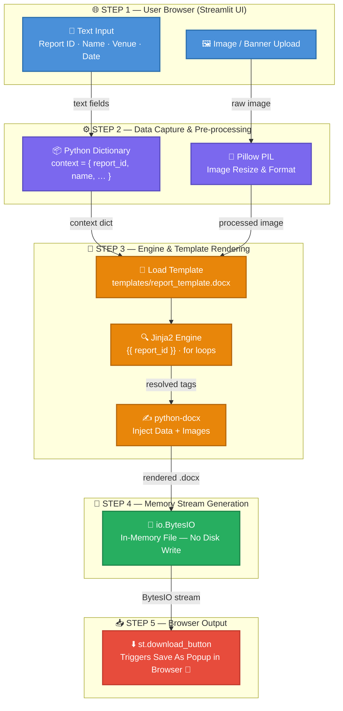
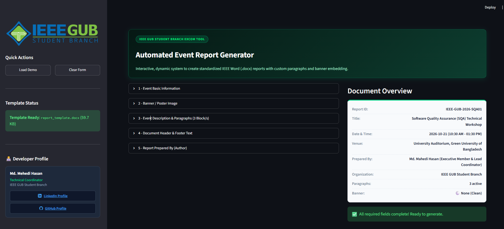
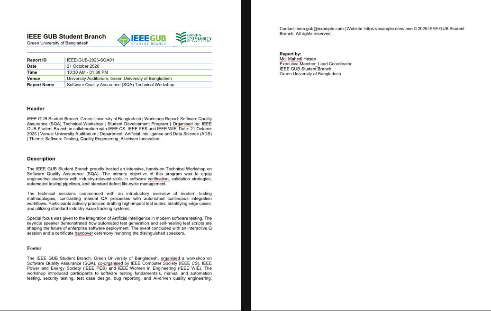

<div align="center">


<br/>

***Automated Event Report Generator***

Fill in a form and download a professional Word report in one click.

<br/>

[](https://ieee-automated-report-generator.streamlit.app)

<br/>


[](https://ieee-automated-report-generator.streamlit.app)


<br/>


[🌐 Live App](https://ieee-automated-report-generator.streamlit.app) •
[ Features](#-key-features) •
[ Workflow](#-system-architecture--visual-workflow) •
[ Tech Stack](#️-tech-stack) •
[ Structure](#-project-structure) •
[ Run](#-how-to-run) •
[ Contributing](#-contributing)

</div>

---

## Description

> A powerful tool that uses a Streamlit UI to automatically generate Word (.docx) reports.
> 
> 🌐 **Live Web Application:** [https://ieee-automated-report-generator.streamlit.app](https://ieee-automated-report-generator.streamlit.app)

---

## System Architecture & Visual Workflow

The complete system workflow, step by step:

```
┌─────────────────────────────────────────────────────────────────────┐
│                    AUTOMATED REPORT GENERATOR                       │
│                      — Visual Workflow —                            │
└─────────────────────────────────────────────────────────────────────┘

 ┌──────────────────────────────────────────────┐
 │   STEP 1 │ User Browser (Streamlit UI)        │
 └──────────────────────────────────────────────┘
        │
        ├──► User enters text input
        │      (e.g., Report ID, Name, Venue, etc.)
        │
        └──► User uploads an image or banner
        │
        ▼

 ┌──────────────────────────────────────────────────────────────────┐
 │   STEP 2 │ Data Capture & Pre-processing (Streamlit + Pillow)    │
 └──────────────────────────────────────────────────────────────────┘
        │
        ├──► Streamlit captures all text data and converts it
        │      into a Python dictionary (context).
        │
        └──► Pillow (PIL) receives the uploaded image and
               prepares it for placement in the Word template.
        │
        ▼

 ┌──────────────────────────────────────────────────────────────────────────┐
 │   STEP 3 │ Engine & Template Rendering (docxtpl + Jinja2 + python-docx)  │
 └──────────────────────────────────────────────────────────────────────────┘
        │
        ├──► The docxtpl library loads the
        │      templates/report_template.docx file.
        │
        ├──► The Jinja2 engine works in the backend, finding the tags
        │      (e.g., {{ report_id }}) and loops inside the template.
        │
        └──► Using python-docx's base structure, it replaces the tags with
               real data and the Pillow-processed image, then renders the file.
        │
        ▼

 ┌────────────────────────────────────────────────────┐
 │   STEP 4 │ Memory Stream Generation (io.BytesIO)   │
 └────────────────────────────────────────────────────┘
        │
        └──► The generated file is not saved to a folder on the PC;
               it is held in Python's memory (BytesIO stream).
        │
        ▼

 ┌────────────────────────────────────────────────────────────────────────────┐
 │   STEP 5 │ Browser Output & "Save As" Popup (Streamlit Download Button)    │
 └────────────────────────────────────────────────────────────────────────────┘
        │
        └──► The file is sent to the user's browser via Streamlit's
               st.download_button(), and the "Save As" popup appears! 🎉
```

---

## Workflow Diagram



---

## Tech Stack

| Library | Purpose |
|---|---|
| **Streamlit** | Builds the browser-based UI and accepts user input |
| **Pillow (PIL)** | Processes and resizes uploaded images |
| **docxtpl** | Loads and renders Jinja2-powered Word templates |
| **Jinja2** | Fills the `{{ tags }}` and loops inside the template |
| **python-docx** | Provides the base structure of the `.docx` file |
| **io.BytesIO** | Keeps the file in memory instead of writing it to disk |

---

## Project Structure

```
Automated Event Report Generator/
│
├── utils/                  # Prepares/processes text and image data for the Word/docx file
│   ├── banner.py           # Banner
│   ├── description.py      # Description
│   ├── event_details.py    # Core event information
│   ├── author.py           # Author / preparer information
│   └── text_helpers.py     # Common header/footer
│
├── templates/                      # Word template
│   └── report_template.docx        # Main .docx file (with Jinja2 tags)
│
├── main/
│   ├── app.py                      # Streamlit frontend (form input & download button)
│   └── report_generator.py         # Report generation engine
│
├── img/
│   └── IEEE_SB.png                 # Logo
│
├── app.py                          # Root entrypoint for Streamlit
├── requirements.txt                # Library dependencies
└── README.md                       # Project documentation
```

---

## How to Run

### 🌐 Live Online (No Installation Needed)

Directly open the live web app in your browser:  
👉 **[https://ieee-automated-report-generator.streamlit.app](https://ieee-automated-report-generator.streamlit.app)**

---

### 💻 Run Locally

```bash
# 1. Install dependencies
pip install -r requirements.txt

# 2. Start the app
streamlit run app.py
```

Then visit `http://localhost:8501` in your browser.

---

## Key Features

- ✅ Simple browser-based UI — usable with no installation
- ✅ Image/banner upload support
- ✅ Dynamic report generation from a Word template
- ✅ File is created in memory — no data is stored on the server
- ✅ One-click `.docx` download

---

## Screenshots

| Streamlit Form | Generated Report |
|---|---|
|  |  |


---

## Contributing

Contributions are always welcome! 🎉

```bash
# 1. Fork the repo, then clone it
git clone https://github.com/YOUR-USERNAME/YOUR-REPO.git

# 2. Create a new branch
git checkout -b feature/your-feature-name

# 3. Commit your changes and push
git commit -m "Add: your feature"
git push origin feature/your-feature-name
```

Then open a **Pull Request** on GitHub.

---

## Author

**Md. Mehedi Hasan** — IEEE GUB Student Branch
🔗 GitHub: [Md. Mehedi Hasan](https://github.com/mehedi-hs-deepnet)

---